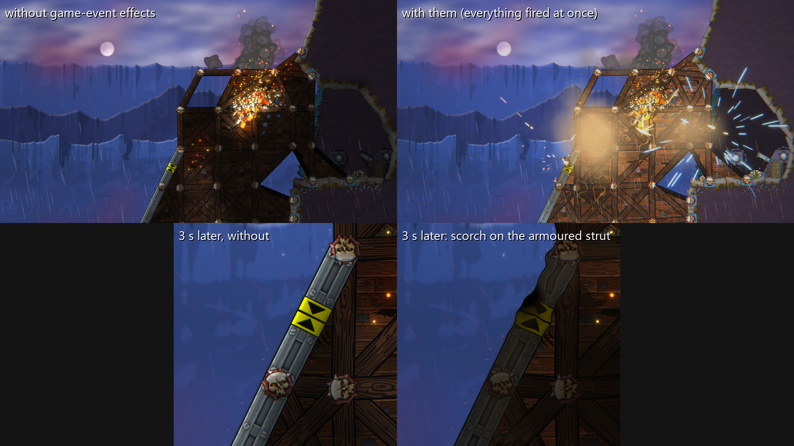
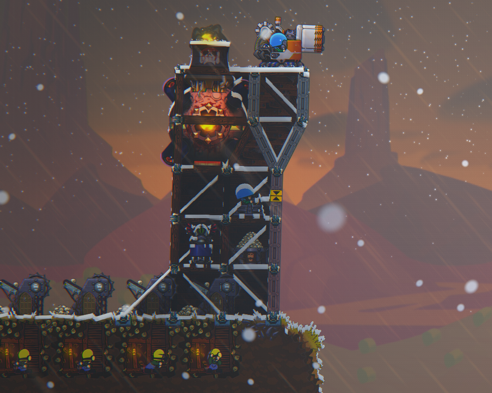
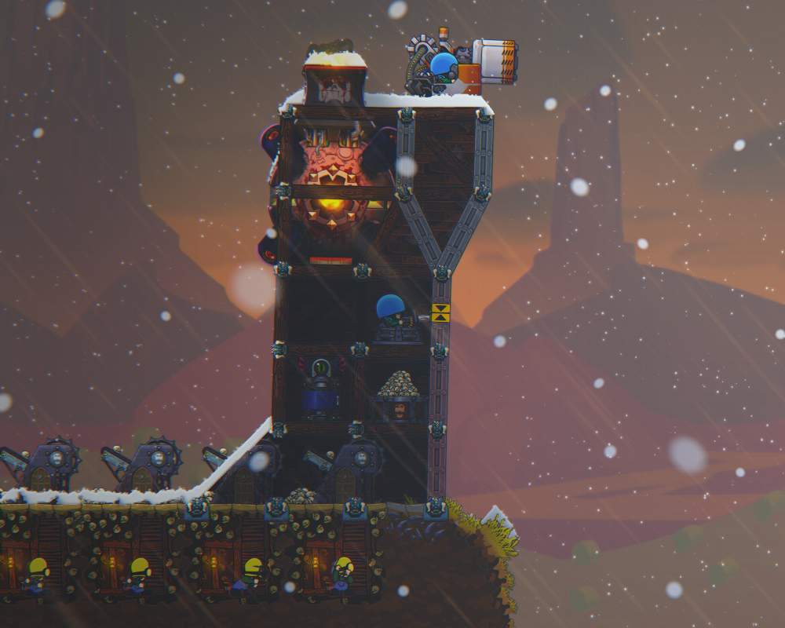
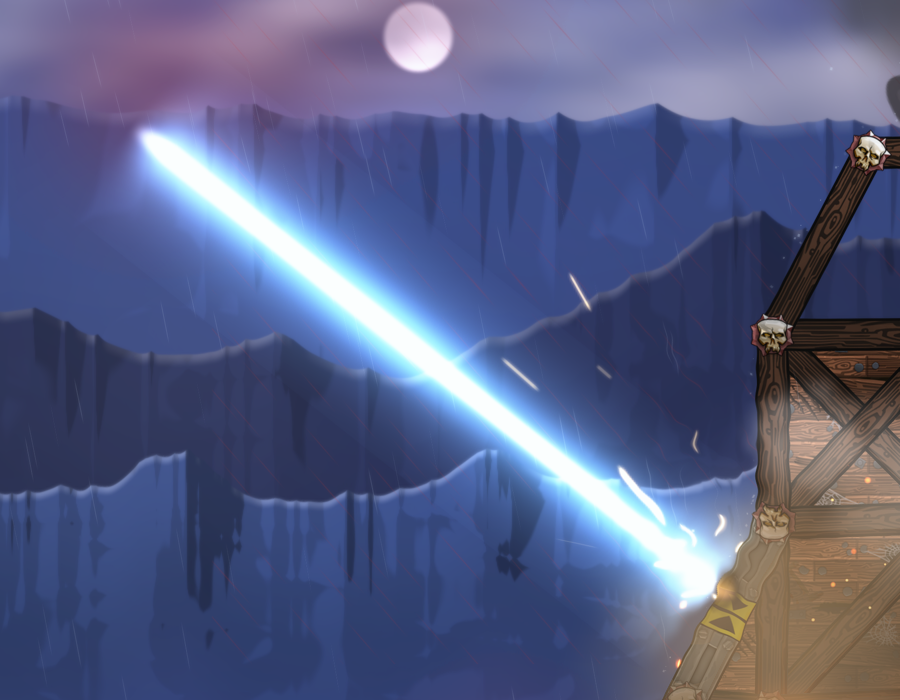
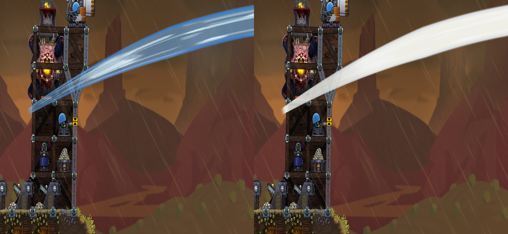
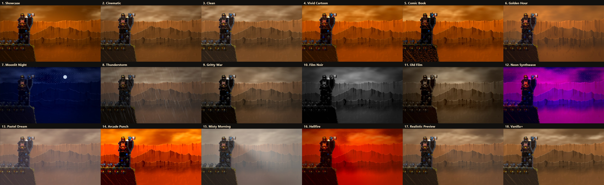
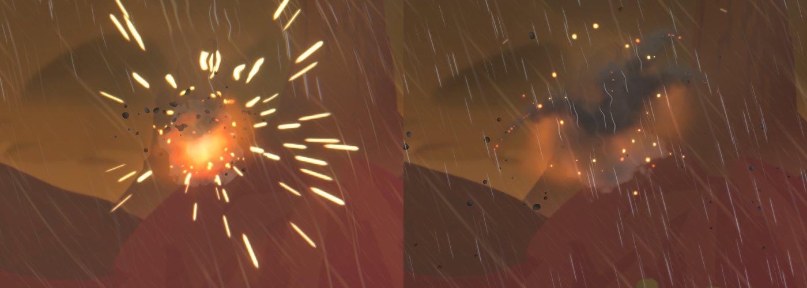

# FortsGFX

A graphics overhaul for [Forts](https://store.steampowered.com/app/410900/Forts/): ray-traced 2D lighting
and shadows, simulated smoke, bigger and more physical explosions, weather, a day/night cycle, water
reflections, 24 colour looks and a photo mode, all adjustable in game.

It's a single `opengl32.dll` that sits next to `Forts.exe`. It isn't a Forts mod, so it works in any map
and in multiplayer, and the other players don't need it. Only you see the effects.



## Install

1. Download the latest `FortsGFX-x.y.zip` from [Releases](https://github.com/Pabloise1/FortsGFX/releases)
   and extract it anywhere.
2. Double-click **install.cmd**. It finds Forts through Steam and copies FortsGFX in. If Windows asks
   whether to run it, choose *Run* (or *More info → Run anyway*).
3. Start Forts. Press **Insert** for the control panel.

Prefer to do it by hand? Copy `opengl32.dll` into the Forts folder (in Steam: right-click Forts →
*Manage* → *Browse local files*), next to `Forts.exe`. That's all FortsGFX needs. The installer also adds
the optional extras below.

If Forts is somewhere Steam doesn't know about, run
`powershell -ExecutionPolicy Bypass -File install.ps1 -GameDir "D:\path\to\Forts"`.

**Uninstall:** double-click **uninstall.cmd**, or delete `opengl32.dll` from the Forts folder.

### Requirements

- Windows 10 or 11, 64-bit, and Forts on Steam.
- Forts' **OpenGL** renderer (the default) is fully supported. **Vulkan** support (since 1.1) is new and still
  being tested: it runs the same effects, but if anything looks wrong with `EnableVulkan = true`, switch Forts
  back to OpenGL, or add `Effects=0` under `[Vulkan]` in `FortsGFX.ini` - and please report it with
  `FortsGFX\vulkan.log`.
- A dedicated graphics card. FortsGFX has been built and tested on one PC so far (RTX 4080 SUPER at 4K).
  If it runs slowly, pick **Quality: Low** in the control panel. Reports from other hardware are very welcome.

## In game

| Key | What it does |
|---|---|
| **Insert** | Control panel: presets, every setting, Save |
| **Home** | Lab bar along the top: looks, before/after, weather, click-to-spawn effects, the showcase tour |
| **F7 / F8** | Previous / next look |
| **F9** | FortsGFX on / off, to compare with the original game |
| **F10** | Lighting and fog on / off |
| **End** | Photo mode: freeze effects, hide the HUD, depth of field, framing, *Save photo* |
| **Ctrl+F9** | Reload settings from `FortsGFX.ini` |
| **Ctrl+Shift+F11** | Capture a frame for a bug report (large: ~170 MB) |

**Changing keys:** open the control panel → **Keys**, click the key next to an action and press the new
one (Esc cancels). It's saved straight away, and *Default keys* puts them all back. Forts still sees these
keys too, so pick ones the game doesn't use.

Settings are saved in `FortsGFX.ini` in the Forts folder. Logs go to the `FortsGFX` folder next to it.

## What it adds

- **Lighting**: fires, explosions, lasers and the sun light the world through ray-traced 2D lighting, with
  real shadows from struts and terrain, soft ambient occlusion and surface shading on every sprite.
- **Looks**: 24 complete styles (Showcase, Cinematic, Vanilla+, Golden Hour, Moonlit Night, Film Noir,
  Neon Synthwave, Comic Book, Dramatic Light...) with bloom, colour grading and sharpening. You can save
  your own.
- **Explosions**: 3D fireballs, debris coloured like what was hit, sparks, embers, flash light, screen
  shake, a shockwave, blast wind that pushes smoke and snow, dust shaken off the structure, scorch marks
  and craters. The effects match what the game says was hit: sparks off armour, splinters off wood,
  ripples on shields.
- **Smoke and steam**: the game's smoke sprites are replaced by simulated puffs that billow, drift on the
  wind and are lit by the scene.
- **Weather**: rain with splashes, wet surfaces and puddle reflections; storms with lightning and thunder;
  snow that settles, piles up and slides off; sandstorms, fog banks and ash. Auto mode follows the map.
- **Day and night**: a 20-minute cycle with dawn, dusk and a moonlit night (can be paused or turned off).
- **Water** (High Seas maps): reflections, ripples, foam and splashes.
- **Weapons**: lasers that charge up and cut with molten slag, missile and shell trails, muzzle smoke and
  heat, heavy-weapon shockwaves.
- **Photo mode** and a **showcase tour** that flips each feature off and on so you can see what it does.

Every part has its own switch in the control panel or the Lab bar.

| | |
|---|---|
|  |  |
| Blizzard | Snow settling and piling up |
|  |  |
| Laser beam | Water |





### Extras the installer adds (optional)

- Four **Sandbox maps**: *FortsGFX Showcase* and *FortsGFX Test Bench*, each also at sea. They're built
  from the game's own template maps when you install. The showcase map plays a guided tour with real
  weapons fire. The test bench fires a scripted sequence and saves frame captures (~2.5 GB in all), so
  only run it if you're testing.
- **The milk miko** (`FortsGFX_fun` folder): a silly joke that turns the DLC water cannon into an anime
  shrine maiden with a milk cannon. Off by default. Turn it on in the Lab bar's *Systems* row.

## Is it safe for multiplayer?

FortsGFX only changes what's drawn on your screen. It doesn't change game files, gameplay or anything
sent to other players. To time effects it reads what the game is doing (which shot hit what) without
changing it.

## Problems?

- **Forts won't start or crashes:** delete `opengl32.dll` from the Forts folder and the game is back to
  normal. Please open an [issue](https://github.com/Pabloise1/FortsGFX/issues) with `FortsGFX\session.log`
  from the Forts folder attached.
- **Nothing looks different:** check that Forts uses OpenGL, not Vulkan, and that `opengl32.dll` is next
  to `Forts.exe`.
- **Too slow:** control panel (Insert) → *Quality: Low*, or turn off lighting with F10.
- **Too much shake or distortion:** control panel → effects preset *Subtle*, or lower *shockwave* in the
  Lab bar's *Explosion* row.

## Building from source

You need Visual Studio 2022 with *Desktop development with C++*.

```
build.cmd                          # -> build\opengl32.dll
powershell -File install.ps1       # installs that build into Forts
powershell -File tools\make_release.ps1 1.0   # -> dist\FortsGFX-1.0.zip
```

How it works (draw interception, the lighting passes, the effects and the offline replay tool) is
written up in [docs/DEVLOG.md](docs/DEVLOG.md).

## Credits

- Control panel: [Dear ImGui](https://github.com/ocornut/imgui) by Omar Cornut (MIT, `third_party/imgui`).
- The milk miko's voice lines were generated with [ElevenLabs](https://elevenlabs.io).
- FortsGFX is a fan project, not affiliated with or endorsed by EarthWork Games. Forts is their game.

Licensed under the [MIT License](LICENSE).
